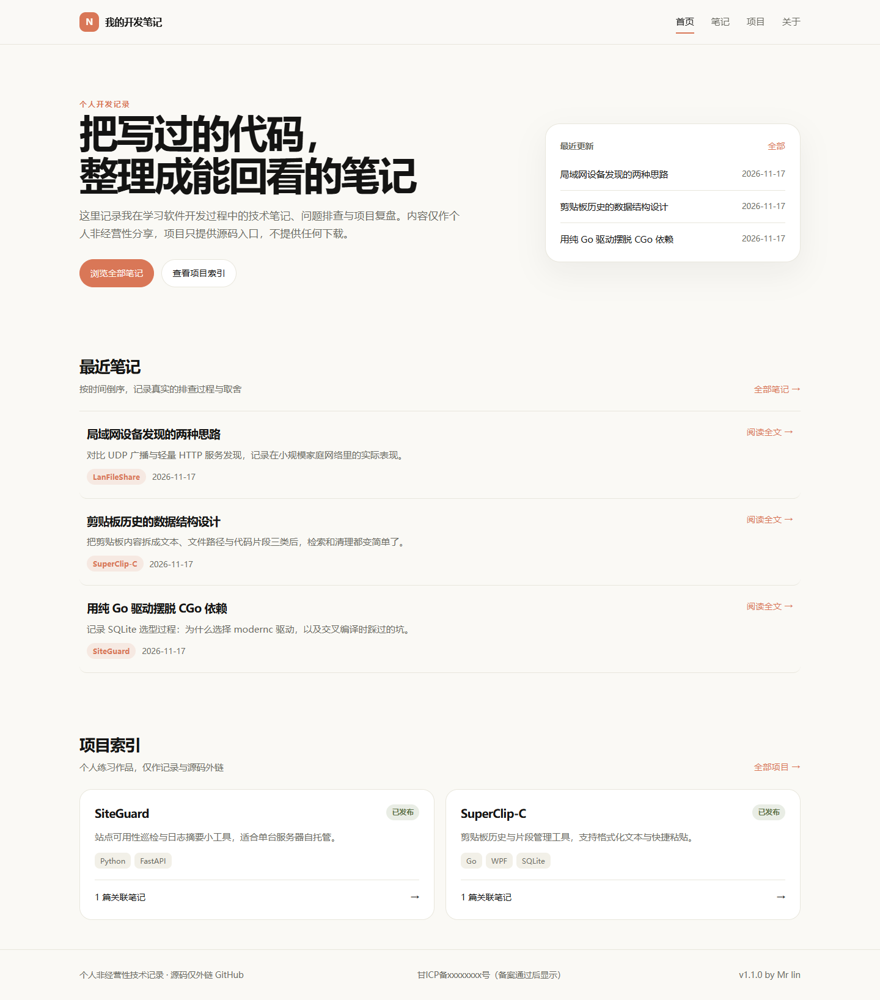
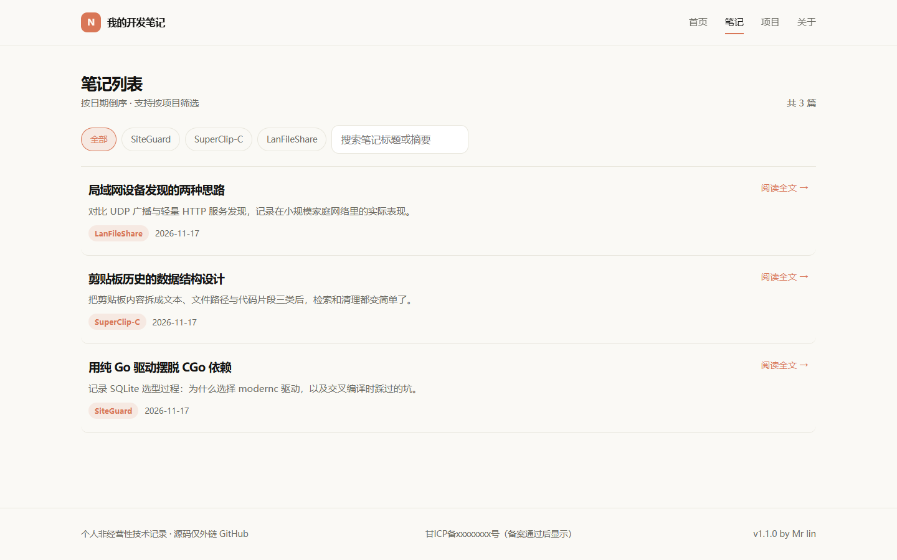
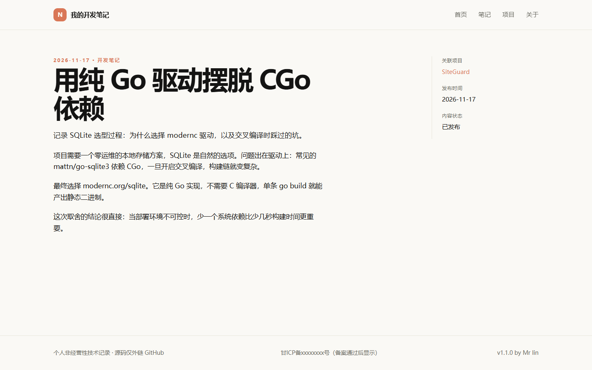
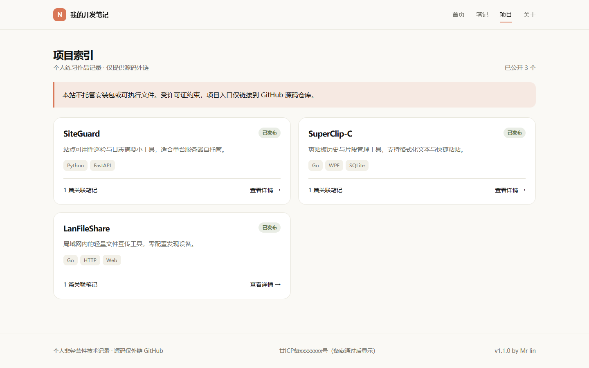
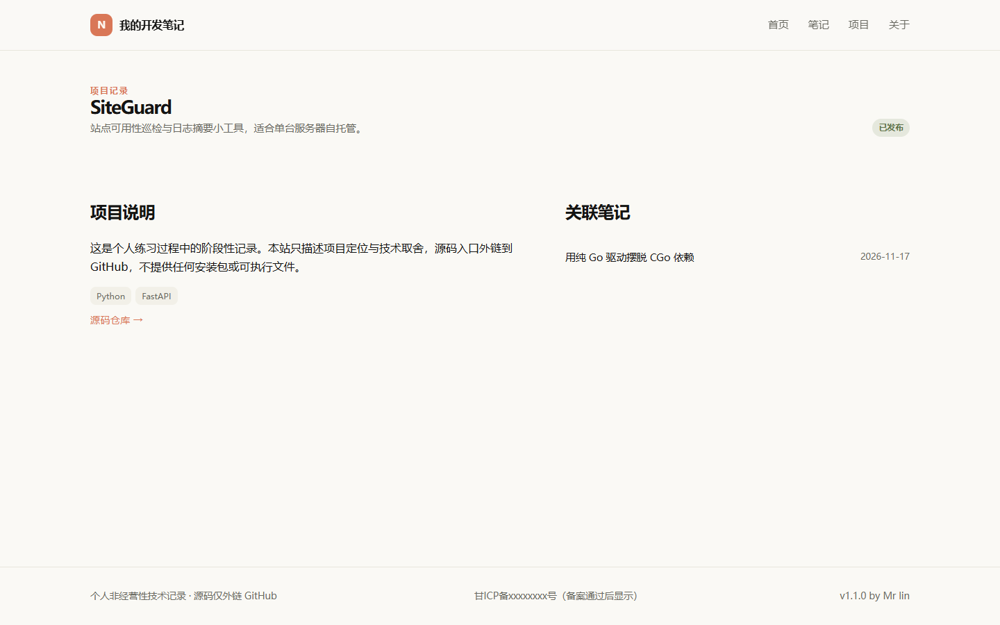
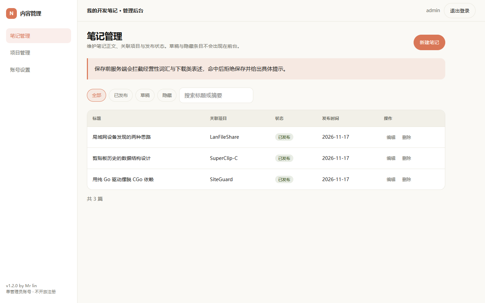
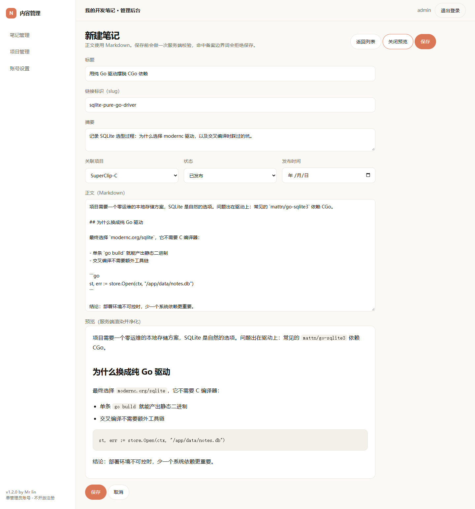

# 我的开发笔记

> **我的开发笔记** · Vue 3 + TypeScript + Go + Gin + SQLite
> 个人非经营性开发记录站点：笔记为主、项目作索引，源码只外链 GitHub。

[](https://www.kernel.org/)
[](https://go.dev/)
[](https://vuejs.org/)
[](https://www.sqlite.org/)
[](CHANGELOG.md)
[](doc/DEPLOY.md)

[English](#english) | [中文](#中文)

## 中文

### ✨ 这是什么

- 一个**只写自己真做过的事**的个人开发笔记站，记录技术笔记、问题排查与项目复盘。
- 首页以笔记为主体，项目只做索引，用来串起零散的尝试和最后的取舍。
- 前台是纯展示：**无注册、无评论、无投稿**，只有本人通过 `/admin` 维护内容。
- 站内**不托管任何安装包或可执行文件**，项目入口只链接到 GitHub 源码仓库。
- 面向甘肃个人 ICP 备案，内容严格限定为「个人非经营性信息分享」。

### 🎯 核心特性

| 特性 | 描述 |
|---|---|
| 笔记驱动 | 首页展示最近笔记与前两个项目，不做产品目录式的观感 |
| 真实接口渲染 | 五个前台页面全部请求 `/api/*`，无前端 mock 数据 |
| 筛选与搜索 | 笔记列表支持按项目筛选、按标题/摘要关键词搜索（后端过滤 + 300ms 防抖） |
| 统一分页 | 前台笔记与后台笔记、项目列表均为 6 条/页，翻页、筛选回首页与窄屏按钮规则一致 |
| 三态可见 | 每个列表都有加载骨架、错误横幅（可重试）与空状态 |
| 单二进制交付 | 前端产物通过 `-tags embedui` 嵌入 Go 二进制，运行时零外部依赖 |
| history 路由 | 真实路径 `/notes/:slug`，Go 侧回退 `index.html`，不用 hash |
| 草稿不外泄 | 公开接口在 Store 层强制过滤 `published`，草稿与隐藏内容进不了前台 |
| 单管理员后台 | 登录、笔记与项目管理、改密；签名 Cookie 会话 + CSRF 双提交 + 登录限流 |
| 保存前拦截 | 经营性词汇与下载类表述在服务端拦截，返回命中词与修正建议，不合规内容存不进去 |
| Markdown 安全渲染 | goldmark 解析 + bluemonday 白名单净化，禁用原始 HTML，图片仅允许站内 `/assets/` 与 `/media/` |
| 项目封面与说明 | 项目可填封面图（站内路径）与 Markdown 详情说明；索引页显示封面，详情页渲染说明 |
| Markdown 编辑器 | 后台写正文/说明时有工具栏、实时分栏预览和站内图片上传；正文仍存 Markdown 原文 |
| 轻依赖 | 前端只有 `vue` 与 `vue-router`，无 UI 库、无状态库、无外部字体 |

### 📸 界面

| | |
|---|---|
| <br>首页 | <br>笔记列表 |
| <br>笔记详情 | <br>项目索引 |

| | |
|---|---|
| <br>项目详情 | <br>后台 · 笔记管理 |

| | |
|---|---|
| <br>后台 · 笔记编辑与预览 | 截图取自本地实例（示例内容），浅色主题，1440px 宽度 |

### 🚀 快速开始

**用户（部署即用）**

当前版本为开发阶段产物，Docker 镜像与 1Panel 部署脚本在 Section 5 补齐，详见 [doc/DEPLOY.md](doc/DEPLOY.md)。拿到二进制后可直接运行：

```bash
cd app
DATA_DIR=/opt/dev-notes/data \
SESSION_SECRET=<32 位以上随机串> \
ADMIN_INIT_USERNAME=admin \
ADMIN_INIT_PASSWORD=<12 位以上> \
HTTP_ADDR=127.0.0.1:8080 \
./build/dev-notes
```

浏览器打开 `http://127.0.0.1:8080/` 即可访问前台。

后台在 `http://127.0.0.1:8080/admin`，用 `ADMIN_INIT_USERNAME` / `ADMIN_INIT_PASSWORD` 登录。初始账号只在 `admin` 表为空时写入一次，之后改密请走「账号设置」页。

**开发者（从源码构建）**

前置：Go 1.27、Node 22、npm。推荐在 WSL（Ubuntu 22.04）中构建。

```bash
# 完整构建：校验版本 → 装前端依赖 → 构建前端 → 静态编译
bash scripts/build.sh
# 产物：app/build/dev-notes（已内嵌前端）

# 单元与接口测试
cd app && go test ./... -count=1

# 本地开发（两个终端）
cd app && DATA_DIR=/tmp/dn-dev SESSION_SECRET=0123456789abcdef0123456789abcdef \
  HTTP_ADDR=127.0.0.1:8080 go run .
cd web && npm install && npm run dev   # Vite 把 /api 代理到 127.0.0.1:8080
```

### 🛠️ 技术栈

| 层 | 选型 | 说明 |
|---|---|---|
| 后端 | Go 1.27 + Gin | 单二进制、`CGO_ENABLED=0` 静态编译 |
| 数据库 | SQLite（`modernc.org/sqlite`） | 纯 Go 驱动，无 CGo；WAL + `busy_timeout` + 单连接 |
| 前端 | Vue 3 + TypeScript + Vite 6 | 组合式 API，无 UI 库 |
| 路由 | vue-router 4（history 模式） | Go `NoRoute` 回退 `index.html` |
| Markdown | goldmark + bluemonday | 服务端渲染并白名单净化，前端只渲染净化后的 HTML |
| 认证 | 签名 Cookie + CSRF 双提交 | 单管理员，无需会话表；改密即让旧会话失效 |
| 校验 | 自定义 `validate` 包 | 字段规则 + 经营性词汇/下载表述拦截，失败返回字段与建议 |
| 样式 | 原生 CSS 变量 | 浅色/暗色双主题，`localStorage` 持久化 |
| 静态资源 | `go:embed` + `embedui` 构建标签 | 默认构建不嵌入，便于本地前后端分离调试 |
| 构建 | `scripts/build.sh` | 版本一致性校验 + 前端构建 + 静态编译 |

### 🔒 数据与隐私

- 所有内容存在单个 SQLite 文件（默认 `/app/data/notes.db`），备份即复制文件。
- 前台无统计脚本、无第三方 CDN、无外部字体、无 Cookie 追踪。
- 后台为单管理员账号，密码用 bcrypt 哈希存储，明文不落库、不进日志。
- 会话用 `HttpOnly` 签名 Cookie（`SameSite=Lax`，12 小时），写操作需 CSRF token；连续 5 次密码错误锁定 15 分钟。
- 正文在服务端渲染并净化：原始 HTML、内联事件、`javascript:` 链接与外链图片都会被移除。
- 仅记录访问日志所需的最小信息（方法、路径、状态、耗时），不记录请求体与 Cookie。

### 📁 项目结构

```text
dev-notes-platform/
├── README.md              本文件（面向使用者）
├── CHANGELOG.md           逐版本变更记录
├── CODEBUDDY.md           工程约定
├── doc/                   设计与交接文档（平铺）
│   ├── DESIGN.md          设计方案
│   ├── PROJECT.md         详细技术方案
│   ├── PROJECT_STATE.md   项目状态、踩坑与待办
│   ├── DEPLOY.md          部署手册
│   └── images/            README 截图
├── app/                   Go 后端
│   ├── main.go            启动、优雅退出、日志
│   ├── VERSION            版本号唯一来源
│   └── internal/
│       ├── api/           公开接口、管理接口、中间件、静态资源回退
│       ├── auth/          会话签名、CSRF、登录限流
│       ├── config/        环境变量与启动校验
│       ├── model/         领域模型
│       ├── render/        Markdown 渲染与 HTML 净化
│       ├── store/         SQLite 迁移与查询
│       ├── validate/      字段校验与词汇拦截
│       └── webui/         前端产物嵌入入口
├── web/                   Vue 前台 + 管理后台
│   ├── src/api.ts         公开接口封装、类型与格式化
│   ├── src/admin.ts       管理接口封装、CSRF 注入
│   ├── src/router.ts      history 路由（含后台）
│   ├── src/views/         五个前台页面
│   ├── src/views/admin/   登录、布局、笔记/项目管理、账号设置
│   ├── src/components/    通用组件
│   ├── public/media/      文章插图（SVG），构建时原样进产物
│   └── vite.config.ts     产物输出到 app/internal/webui/dist
├── content/notes/         文章源（Markdown + 头部字段），随代码版本化
├── tools/
│   └── import-notes.sh    批量导入文章（按 slug 幂等）
├── prototype/             已确认的第一版界面原型（冻结基线）
├── prototype-v2/          第二版候选（归档，不参与构建）
├── deploy/                容器编排（Section 5）
├── scripts/build.sh       构建脚本
└── test/                  端到端测试脚本（Section 5）
```

### 🖱️ 常用操作

| 想做什么 | 怎么做 |
|---|---|
| 浏览全部笔记 | 顶部导航「笔记」，或首页「浏览全部笔记」 |
| 按项目筛选笔记 | 笔记列表上方点击项目名 |
| 搜索笔记 | 笔记列表右上角输入关键词，停止输入 300ms 后自动查询 |
| 查看项目与关联笔记 | 顶部导航「项目」→ 点击卡片 |
| 回到源码仓库 | 项目详情页「源码仓库 →」（新窗口打开 GitHub） |
| 切换浅色/暗色 | 右下角主题按钮，刷新后保持 |
| 配置 ICP 备案号 | 后台「站点设置」填入备案号并保存，前台页脚即时更新；留空则继续显示占位文案 |
| 进入后台 | 直接访问 `/admin`（前台不放入口，仅自己手输地址） |
| 新建/编辑笔记 | 后台「笔记管理」→「新建笔记」，或行内「编辑」 |
| 写 Markdown 正文 | 编辑页工具栏点标题/粗体/列表/链接等按钮，右侧边写边预览；可切「仅编辑 / 仅预览」 |
| 给文章插插图 | 正文编辑区点「图片」选文件自动上传到站内，或手填已有站内路径 `` |
| 给项目加封面与详情说明 | 后台「项目管理」→ 行内「编辑」→ 点「选择图片上传」自动填封面路径（PNG/JPG/WEBP、≤2 MB），「项目说明」用 Markdown 编辑器写，右侧实时预览后保存 |
| 批量导入文章 | 文章写进 `content/notes/*.md`，执行 `ADMIN_PASSWORD=密码 bash tools/import-notes.sh`（已存在的 slug 默认跳过，`MODE=update` 覆盖） |
| 修改密码 | 后台「账号设置」，当前页面会自动续期 |
| 构建可交付二进制 | `bash scripts/build.sh` |
| 跑后端测试 | `cd app && go test ./... -count=1` |

### 🐛 故障排查

| 症状 | 原因 / 修复 |
|---|---|
| 页面空白、控制台报 404 | 前端产物未嵌入：用 `bash scripts/build.sh` 构建，或确认 `-tags embedui` |
| 直接访问 `/notes/xxx` 404 | 反向代理未放行全路径；需把所有路径转给 Go，由 `NoRoute` 回退 |
| 前端请求 `/api` 失败 | 开发时确认 Vite 代理与后端端口一致（默认 `127.0.0.1:8080`） |
| 启动报「SESSION_SECRET 至少需要 32 个字符」 | 换成长度 ≥32 的随机串 |
| 启动报「管理员账号必须同时设置」 | `ADMIN_INIT_USERNAME` 与 `ADMIN_INIT_PASSWORD` 成对设置 |
| 后台一直跳登录页 | 会话过期（12 小时）或改过密码；重新登录即可 |
| 登录提示「账号或密码不正确」 | 初始账号只在首次启动且 `admin` 表为空时写入；确认启动时带了 `ADMIN_INIT_*` |
| 登录提示「失败次数过多」 | 连续 5 次密码错误会锁定 15 分钟，等待或重启进程（计数在内存中） |
| 保存提示「请求校验失败」 | CSRF token 过期，刷新页面后重新提交 |
| 后台登录成功却立刻跳回登录页 | 会话 Cookie 没落地：保持 `COOKIE_SECURE=auto`（默认），仅在全程 HTTPS 时才设 `true` |
| Windows 上 `127.0.0.1:端口` 打不开、`localhost:端口` 正常 | WSL2 转发只监听 IPv6 回环，改用 `localhost` 访问 |
| 保存被拒绝且列出命中词 | 内容含经营性词汇或下载类表述，按提示改为「源码仓库」等合规表述 |
| 正文里的图片不显示 | 只允许 `/assets/`（前端产物）与 `/media/`（文章插图）站内路径，外链图片会被净化移除 |
| 项目卡片显示 0 篇关联笔记 | 该项目的笔记尚未发布；`note_count` 只统计 `published` |
| 项目封面不显示 | 封面只收站内图片路径（`/media/…` 或 `/assets/…`，扩展名 png/jpg/webp/svg/gif）；填外链或相对路径时保存会被拒绝 |

### 📜 更新日志

当前版本 **v1.4.5**（Section 3 已完成；Section 4 进行中：8 个项目、31 篇笔记，均为真实技术复盘，项目卡片指向真实源码仓库）。

逐版本明细详见 [CHANGELOG.md](CHANGELOG.md)。

### 📄 许可证

本项目为个人站点工程，暂未声明开源许可证。源码公开仅用于阅读参考，未授权再分发或商用。

## English

### What is this

A personal, non-commercial developer-notes site: Markdown notes are the main content, projects act only as an index, and links point to GitHub source repositories instead of hosting any binaries. The public site is read-only — no registration, comments, or submissions; a single admin maintains content through `/admin`.

### Tech Stack

Go 1.27 + Gin + SQLite (`modernc.org/sqlite`, pure Go) on the backend, Vue 3 + TypeScript + Vite 6 on the frontend, goldmark + bluemonday for server-side Markdown rendering and sanitizing, plain CSS variables for theming, and the built frontend embedded into the binary with `go:embed` behind the `embedui` build tag.

### Quick Start

```bash
bash scripts/build.sh            # builds web + static Go binary -> app/build/dev-notes
cd app && DATA_DIR=/tmp/dn-data SESSION_SECRET=0123456789abcdef0123456789abcdef \
  ADMIN_INIT_USERNAME=admin ADMIN_INIT_PASSWORD=admin12345678 \
  HTTP_ADDR=127.0.0.1:8080 ./build/dev-notes
```

Open `http://127.0.0.1:8080/` for the public site and `/admin` for the console. For development run `cd app && go run .` and `cd web && npm run dev` (Vite proxies `/api` to port 8080).

### Data & Privacy

Content lives in a single SQLite file, so backups are a file copy. No analytics, no CDN, no external fonts, no tracking cookies. The admin password is stored as a bcrypt hash and never logged; sessions use a signed `HttpOnly` cookie with CSRF tokens on writes, and Markdown is sanitized server-side (raw HTML, inline handlers, `javascript:` links and external images are stripped).

### License

No open-source license is declared yet. The source is public for reading only; redistribution and commercial use are not granted.
